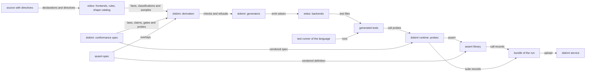

<!--
  ~ Copyright Dokimasia B.V. 2026
  ~ SPDX-License-Identifier: Apache-2.0
-->

# RFC-0001: The purpose and scope of dokimi

## Summary

dokimi defines what an implementation must do to conform to a shape, and it generates the conformance suites of a codebase with the proof that each check can fail. The conformance spec of dokimi is versioned data. It contains the laws of each shape, mixin and contract of the shape catalog of eidos, the claims that each classification licenses, the probes that check the claims and the reason codes of their failures. One derivation turns the spec into the checks of each contract that a codebase declares. A contract is an interface, a concrete type, a function, an enumeration or an error value. Every check comes with a planted defect. Each planted defect is an implementation of the contract that is correct except for the one law that its check verifies. Falsification runs the check against its planted defect and fails unless the check fails with the reason code of its claim.

The binary reads source code through eidos and writes the tests in the language of the source. Each generated check calls a probe of the runtime of its language, and the probe asserts through the assert library of that language. The tests run under the test runner of the language and write the records that assert-spec defines. A mutation run of the tests writes the records that mutate-spec defines. Each run uploads its results to the service of dokimi, which shows what each suite claims, what it proved and what it refused.

Beside the checks, dokimi generates doubles, fixture builders, verified fakes, benchmarks and fuzz targets. Its tiers exercise a contract under a controlled clock, under faults on demand, under generated sequences against a reference implementation, under concurrent callers and under crashes and broken storage. This RFC sets the purpose, the concepts, the components and the invariants of dokimi. It also gives a verdict for each capability and each language.

## Motivation

A test that cannot fail looks the same as a test that works, because both pass. The difference appears only when a defect that the test should have caught is found in production.

The same contracts recur in every codebase:

- A read returns the zero value beside an error.
- A call with a cancelled context reports the cancellation.
- An append returns a position above the position of the append before it.
- An entry stops being readable once its lifetime passes.

Each declaration with such a callable needs the same checks for every implementation. Teams write these checks by hand for each declaration, or they do not write them.

The laws of these contracts do not depend on a language. In Go and in TypeScript, an entry stops being readable once its lifetime passes. When each language states the laws in code of its own, the languages drift apart, and the drift shows only when a consumer compares two of them. dokimi states the laws once in data that every language reads. One corpus checks each language against that data.

Existing tools measure tests or run them. A person still decides which checks a contract needs:

- Coverage reports which lines ran. It does not report whether an assertion could fail.
- Mutation tools such as dokimi-mutate-go, PIT and Stryker measure a finished suite. A killed mutant shows that some test noticed a change. It does not show which contract that test verifies, and each mutant costs one run of the suite.
- Property-based testing libraries such as QuickCheck, Hypothesis and rapid run the properties that a person writes. They do not decide which properties a type must have.
- Conformance helpers such as `fstest.TestFS` and `iotest.TestReader` in the Go standard library cover one interface each. The contracts of a consumer get nothing from them.
- A test written from an implementation takes its expected values from that implementation, so it passes on the defects that it should catch.

dokimi derives each check from a declaration, the shapes that eidos detects in its signatures and the conformance spec. It never derives a check from the behaviour of the implementation under test. Each check comes with a planted defect for that check alone. Falsification accepts a failure only when the probe reports the reason code of the claim. A passing suite then shows that each check failed on its planted defect for the stated reason and that the subject passed the check.

testkit generates conformance checks for Go interfaces and proves each check against a planted defect. Its design does not extend past Go:

- It reads only Go.
- It composes on an earlier API of eidos.
- Its report does not leave the test process.
- It matches a failure by a substring of the failure text. The same failure in another language has other text.

The neighbouring projects leave the choice of checks and their proof to their users:

- eidos reads source code in Go, TypeScript, Rust, Java and protobuf, classifies each callable and renders files. It leaves the choice of checks to its consumer.
- assert-spec defines the assertions and the records of a test run, and an assert library implements it in each language. Neither defines a law of a shape.
- mutate-spec defines the records of a mutation run, and dokimi-mutate-go measures the tests of Go code.

## Detailed design

### Goals

- Define the conformance of each shape, mixin and contract of the shape catalog once, as versioned data that every language reads.
- Generate the tests of a declared contract in the language of its source, for interfaces, concrete types, functions, enumerations and error values.
- Derive the checks of every language with one derivation from the conformance spec.
- Prove each generated check against a planted defect, and match its failure by the reason code of its claim.
- Check every language against the conformance spec with one corpus, so that a difference between two languages is declared or fails the build.
- Assert through the assert library of the language in every probe, and write the records that assert-spec defines in every run.
- List every refused claim with its remedy, and every classification without a check with its stance, in the generated file and in the suite record.
- Exercise each contract with the machinery that its laws need, from a single caller up to crashes of a process and breaks of its storage.
- Run the generated tests with the toolchain of their language alone.
- Show the claims, the proofs, the refusals and the measurements of every run in one service.

### Non-goals

| Work | Done by |
|---|---|
| Parsing source code and formatting generated files | eidos |
| Defining assertions and the records of a test run | assert-spec, and the assert library of each language |
| Defining the records of a mutation run | mutate-spec |
| Running tests | The test runner of each language |

dokimi does not derive a check from the behaviour of an implementation, because a check derived that way passes on the defects of that implementation. A passing suite shows that each check can fail and that the subject passed it. It does not show that the program is correct.

### Concepts

| Term | Meaning |
|---|---|
| Subject | An implementation under test, such as a type that implements an interface |
| Declaration | An interface, a trait, a protocol class, a service, a concrete type, a function, an enumeration or an error value in the source, with the directives that its author writes on it |
| Classification | A shape, a mixin or a contract role of a callable. The shape catalog of eidos detects shapes from signatures. Directives set shapes and add mixins and contract roles |
| Conformance spec | The versioned data of dokimi that defines the conformance of each shape, mixin and contract: the laws, claims, gates, probes, reason codes, machineries and stances |
| Law | A statement about a subject that is true or false, such as `no-value-beside-an-error`. The service counts coverage per law. assert-spec uses the word property for a body that passes for every generated input |
| Claim | A statement that a classification licenses, such as "Read returns the zero value beside an error". Its check witnesses one law |
| Licence | The classification that a claim requires |
| Gate | A condition on the facts of a callable that a claim requires, such as "the callable can fail" |
| Check | The generated test of one claim on one callable |
| Check identity | `<declaration>.<callable>/<segment>` with an optional `#<case>`, such as `Store.Read/zero-on-error` |
| Probe | The procedure of a check. The conformance spec defines its inputs and its reason codes, and each runtime implements it |
| Reason code | The identifier of a violation that a probe reports, such as `value-beside-error` |
| Assertion | An assertion of assert-spec, such as `equal` or `idempotent`. A probe asserts through the assert library of its language |
| Planted defect | An implementation of the declaration that is correct except for the law of one check |
| Falsification | The run of each check against its planted defect. It fails when the check passes, or when the check fails with another reason code |
| Control | A correct implementation that differs from the subject. Every check that it does not excuse must pass on it |
| Refusal | A licensed claim whose gate is false for a callable. The generated file lists it with its reason and remedy |
| Stance | The reason why a classification has no check, such as a machinery that the run does not supply |
| Machinery | What a run must supply before a check can exercise its claim, such as a clock that the run advances |
| Tier | The machineries that a generator supplies |
| Vacuous check | A check that ran on a subject and never exercised its claim |
| Verified fake | A generated in-memory implementation of a declaration that passes the suite of the declaration |
| Budget | A declared limit on the time or the allocations of a callable, which a benchmark turns into a check |
| Suite record | The record of one application of a suite: the result and the reason code of each check, the refusals and the unclaimed classifications |
| Bundle | The artifacts that the test runner writes for a run, with the call records of assert-spec, the suite records of dokimi and the trace files of the tiers |
| Service | The hosted product that stores the bundles and uploads of runs and shows them |

### From source to service



Generation, test runs and uploads are separate:

1. `dokimi run` reads the source, derives the checks from the conformance spec and writes the generated files into the repository of the consumer.
2. `dokimi run --check` fails when the committed files differ from a fresh run. CI runs it as the gate of generation.
3. The test runner of the language runs the generated tests. Each check calls a probe of the runtime, and the probe asserts through the assert library. The runtime applies each check to the subject and to its planted defect. The assert library writes a call record for each assertion call into the artifact of the test runner, and the runtime writes a suite record there for each application of a suite.
4. CI uploads the bundle with the results of the other tools of the run, such as coverage and mutation records, to the service.

### An example

The directive `dokimi:suite` on the Go interface below selects the suite generator.

```go
// Store maps keys to values.
//
//dokimi:suite
type Store interface {
	Put(ctx context.Context, v Value) error
	Read(ctx context.Context, key string) (Value, error)
}
```

The shape catalog of eidos classifies `Read` as a reader. In the conformance spec, a reader licenses the claim that the callable returns the zero value beside an error. `Read` passes the gates of the claim. It returns an error beside one value, and eidos derives two samples of `Value`. The suite of `Store` contains this check:

| Part | Value |
|---|---|
| Identity | `Store.Read/zero-on-error` |
| Statement | Read returns the zero value beside an error |
| Law | `no-value-beside-an-error` |
| Probe | `zero-beside-error`. It calls `Read` with sample inputs and with a cancelled context, and it asserts `equal` between the value of a failed call and the zero value |
| Reason code | `value-beside-error` |
| Planted defect | A Store whose Read returns a value beside an error |

The falsification test runs the check against the planted defect. It passes only when the probe reports the reason code `value-beside-error`. If eidos derived no sample of the type of `key`, the check could not call `Read`. The generated file would then list the claim under its refusals, with the remedy to author a sample through the directive `sample`.

The same directive on a concrete type selects the same claims for each method of the type, and the generator writes an interface of the method set for the planted defects to implement.

### Components and repositories

| Component | Repository | Contents |
|---|---|---|
| dokimi | `dokimasia/dokimi`, the Go module `go.dokimi.dev/dokimi` | The conformance spec, the binary `dokimi` with its derivation, its generators and the command `conform`, and the corpus |
| A runtime per language | `dokimasia/dokimi-<lang>`, published to the registry of the language | The packages that generated tests import: the probes of the conformance spec, the suite engine, falsification, typed doubles, fault injection and the writer of suite records |
| assert-spec | `dokimasia/assert-spec` | The definition of every assertion and of its name in each language, the failure record and the call record, the property engine, the machines, the checkers of histories, the benchmark ceilings and the controlled clock |
| mutate-spec | `dokimasia/mutate-spec` | The definition of a mutation run and of its record |
| The assert libraries | `dokimasia/assert-go`, `dokimasia/assert-typescript` and the other assert repositories | The implementation of assert-spec in each language. The probes of each runtime assert through them |
| The service | A repository of its own | The ingest of bundles and uploads, the store, the queries, and the interface that shows runs, tests, findings, properties, checks, mutation, coverage and pull requests |
| eidos | `dokimasia/eidos` | Frontends, rules, the shape catalog, samples, directives, rendering and the command kernels |
| dokimi-mutate-go | `dokimasia/mutate-go` | Mutation testing of Go code. Its run records go to the service, and it reads no output of dokimi |

The conformance spec defines the conformance of shapes. assert-spec and mutate-spec define what a test asserts and what a run records, and neither defines a shape. dokimi vendors both definitions, and each runtime vendors the conformance spec of a release of dokimi. dokimi requests an assertion from assert-spec when a probe needs one that assert-spec lacks.

### Who decides what

| Decision | Made by |
|---|---|
| Which files to read, and what they declare | The frontend of eidos for the language |
| The role of each parameter and return, and the error model of a callable | The rules of eidos for the language |
| The classifications of a callable | The shape catalog of eidos, and the author through directives |
| The sample values of a type, and the type arguments of a generic declaration | The rules of eidos, and the author through the directives `sample` and `witness` |
| Which claims a classification licenses, and under which gates | The conformance spec |
| The law, the probe, the reason code and the planted defect of a claim | The conformance spec |
| How a probe runs in a language | The runtime of the language, through its assert library |
| What an assertion means, and its name in each language | assert-spec |
| What a language cannot assert | The overlay of the language in assert-spec |
| The form of a generated test in a language | The template tree of each generator for that language |
| How an assertion fails, and the call records that a run writes | The assert library of the language, as assert-spec defines them |
| The suite records that a run writes | The runtime of the language, as the conformance spec defines them |
| When and where tests run | The test runner of the language |
| How a run is shown and compared with other runs | The service |

### Invariants

| Invariant | Enforced by |
|---|---|
| Every check comes with a planted defect, and falsification fails when the check passes on it | The suite generator writes the defect. The runtime runs falsification |
| Falsification matches a failure by its reason code and never by its text | The test handle of each runtime, and the corpus |
| Every refused claim and every classification without a check appears in the generated file and in the suite record, with a remedy or a stance | The suite generator and the runtime |
| Every classification of the shape catalog has a claim or a stance | A test of the conformance spec |
| A check that runs on a subject without exercising its claim fails the run | The suite engine of each runtime |
| A check that disappears from a regeneration fails the generation gate | The suite generator |
| A generated test runs without the binary and imports none of its packages | The template trees, and a test of each binding |
| The derivation contains no rule for a single language | depguard on the package of the derivation |
| A generated file and its runtime agree on their major version, or the build of the consumer fails | The compatibility constant of each runtime |
| A claim has one meaning in every language | One conformance spec, and the corpus that every language runs |
| The corpus has a control for each shape family that differs from its subject | The corpus |
| A suite record has an identity, a version of the conformance spec and a seed | Each runtime |
| The service shows no single score without the parts that it is made of | The service |

### Capabilities

Each capability above the suite tier has a design of its own. The verdicts follow.

#### What dokimi generates from

| Capability | Verdict | Reason | Reverses when |
|---|---|---|---|
| Interfaces, traits, protocol classes and services | In | Several implementations satisfy one declaration, and each needs the same checks | — |
| Concrete types, through their method sets | In | A consumer gets a suite without declaring an interface for it | — |
| Functions and the functions of a module | In | A function has claims of its own, such as purity, idempotence and a declared domain | — |
| Enumerations and error values | In | Callers rely on the identities and the names of their members | — |
| Compositions of several declarations | In | A claim about a composition, such as a cache in front of a store, needs both parts | — |

#### What dokimi generates

| Capability | Verdict | Reason | Reverses when |
|---|---|---|---|
| Suites of checks with planted defects | In | They are the purpose of dokimi | — |
| Typed doubles with fault injection | In | A planted defect is a double with one method replaced, and consumers test their callers against doubles | — |
| Fixture builders | In | Checks and the tests of consumers need values of the declared structs | — |
| Verified fakes | In | A downstream team runs a fast substitute in its CI, and the suite of the declaration enforces its fidelity | A team passes against the fake and fails against the real implementation on a behaviour that the contract covers |
| Benchmarks of each callable with derived inputs | In | The service shows their trends. A declared budget, through the benchmark ceilings of assert-spec, turns a benchmark into a check that a planted defect can falsify | A budget check on a planted defect cannot fail without flaking |
| Fuzz targets from the claims of a suite | In | A suite exercises each claim on the samples of eidos. A fuzzer searches the inputs that the samples miss, and the planted defect still proves each fuzzed claim | Fuzzed claims find no defect in the corpus that the samples miss |
| Planted defects for checks that consumers write | In | dokimi derives stateful defects from the declared laws, such as a failure that clears after one call or a recovery that loses the state, which mutation tools do not produce | — |
| Planted defects that a language model writes | In | A wrong defect produces a visible false failure and never a false pass | Reviewers judge most model-written defects to be legal behaviour |
| The lock of check identities and the generation gate | In | A lost check must be visible in review | — |
| Bundles in versioned formats, and local aggregation of the bundles of one repository | In | The service, the gates and a developer without the service read the same files | — |

#### Machineries

| Capability | Verdict | Reason | Reverses when |
|---|---|---|---|
| A single caller and a clock that the run advances | In | These are the suite tier | — |
| Clock skew, drift, rollback and bounded uncertainty | In | A protocol that waits out the uncertainty of a clock needs a check of the wait | Injected skew fails correct subjects without revealing a defect |
| Calls that fail on demand | In | Claims about retries, latched failures and rollback need a call that fails when the check asks for it | The faults that a runtime can inject produce checks that no deployment can trigger |
| Generated sequences judged against a reference implementation | In | Claims about histories, such as read-after-write, are statements about sequences. A reference that is separate from the subject gives expected values that do not come from the subject | A claim about histories needs a hand-written mapping per interface between the declaration and the reference |
| Concurrent callers, with the linearizability and the isolation of the recorded histories checked | In | A contract that breaks only under concurrent calls passes every sequential check | — |
| A second subject for differential comparison | In | Two implementations that return different results for one generated sequence show a defect in one of them, as in a migration | — |
| A killable process and a breakable medium | In | Durable subjects lose data on torn writes, lost syncs, bit rot and a full disk, which no check on a healthy medium produces | A subject that is durable on real media fails the injected faults |
| Cross-version evolution | In | Version N+1 must read what version N wrote, and a rollback must survive what N+1 wrote | — |
| Replay of recorded call sequences | In | Recorded sequences exercise states that derived sequences miss | — |
| Controlled interleavings | Out | No language in scope lets a test choose the schedule of an unmodified subject | An opt-in synchronization package, controlled by the scheduler under a build tag, reproduces a known race from a schedule identifier on a second machine |

#### The proof

| Capability | Verdict | Reason | Reverses when |
|---|---|---|---|
| Falsification, specificity controls, vacuity, depth pairs and the audit of evidence | In | Each one shows a different way in which a check can be wrong | — |
| A diagnosis of a failed proof | In | A proof fails because of a weak oracle, an unreached state, an unpropagated fault or an equivalent defect, and only the first is a defect of the check | — |
| A diagnosis of a failing check with a proposed patch for a person to accept | In | A shrunk trace across an interleaving is hard to read, and a proposal costs nothing to reject | A confident diagnosis is wrong on a failure that a person diagnoses correctly |
| Reports of dead and subsumed checks, from mutants attributed to checks | In | A check that kills no defect is an error, and a check that kills only what another check kills is a warning | A check reported dead that a reviewer confirms is needed |
| Saturation, beside the vacuity and the stances of the unclaimed classifications | In | It is the share of checks proven able to fail, which no other tool computes | — |
| A study of planted defects against historical defects | In | It measures whether a check proven against a planted defect also fails on the real defects of the corpus fixtures | — |

#### Declarations

| Capability | Verdict | Reason | Reverses when |
|---|---|---|---|
| Validation of every directive by default | In | A declaration whose validation is off passes a misspelled role | — |
| A finding for a misspelled brand | In, in eidos | eidos removes the brand from each carrier, so only eidos sees a carrier with a misspelled brand | — |
| A finding for an expected value that flows from the subject | In | An expectation that the subject computes moves with the defect, so the check cannot fail | A reviewer confirms a finding as false |
| Contradictions between a declaration and its implementation | In | A directive can be well-formed, name real members and still be false | A reviewer judges a reported contradiction correct on both sides |
| Directive proposals that a person accepts | In | Most declarations do not have directives, and their authors rarely know which laws apply | An accepted proposal produces a suite that passes against an implementation that violates the documented behaviour |
| Directives written without review | Out | A wrong directive produces a passing suite for the wrong law | — |

#### Distribution

| Capability | Verdict | Reason | Reverses when |
|---|---|---|---|
| Conformance of each language binding by artifact, with declared divergence and conformance levels | In | An undeclared difference between languages fails the corpus, and a declared one is visible | — |
| Packs of laws, claims and probes from third parties, in the format of the conformance spec | In | A company states its own laws, such as "every write is audited", under a namespace. The pack implements its probes in each language that it supports | — |
| A signature over a bundle and its lock | In | A downstream consumer verifies that the interface of a supplier passed its suite at a commit | — |
| A compiler from a counterexample of a model checker to a regression check | In | A trace is structured data, and its check comes with a planted defect | A compiled check passes against the implementation that the model checker reported |
| A library of laws from incidents | In | An outage class recurs, and a law in a shared library runs in every gate | — |
| The plan beside the declaration in an editor | In | An author sees which claims a declaration licenses and which refuse | — |

#### The service

| Capability | Verdict | Reason | Reverses when |
|---|---|---|---|
| Ingest of bundles and of the uploads of the other tools of a run | In | One store joins tests, properties, history checks, mutation and coverage of every run | Teams do not add the upload to CI |
| Pages for runs, tests, findings, properties, checks, mutation, coverage and pull requests | In | Each page shows one kind of result with its history on the default branch | — |
| Interface conformance, proven green, the depth of each law across a fleet, the parity matrix and certification queries | In | Only the suite records of dokimi contain what a suite claims, at which depth and in which language | Pilot teams read proven green as coverage |
| A comment on each pull request with the claims that it adds and loses | In | A lost claim is attributed to a person, a date and a reason | — |
| A quarantine of flaky checks that expires, with a ticket and the replay seed | In | A property that fails once in a thousand runs usually reports a real race | — |
| A single headline score | Out | Deleting hard checks raises it | — |

#### Outside the scope

| Capability | Verdict | Reason | Reverses when |
|---|---|---|---|
| Repair that merges its own patch | Out | The suite that approved a patch cannot check it, and patches that delete the feature pass their suites | A verification step proves the law that the patch claims to fix |
| A digital twin of production | Out | A prediction from a simulation of production needs a faithful model of production, which nobody has | — |
| Proofs of conformance in zero knowledge | Out | A proof of a test run states that the tests passed, which a signature over the bundle states already | — |
| A matrix of Byzantine faults | Out | It needs a simulated network to inject into | A simulated network exists and a consumer runs a consensus protocol |
| Debugging that steps back and forth through a trace | Out | No multi-node trace exists to show | A simulated environment records multi-node traces |
| Concolic execution | Out | It needs a symbolic model of the runtime of each language. Generation guided by vacuous checks exercises many of the same states | Guided generation proves insufficient |
| Export of claims to a model checker | Out | The mapping from the claims to the model fails without a sign | The mapping can be checked against the implementation |

### Languages

dokimi supports a language through a binding. A binding has four parts:

- an eidos satellite with rules for the language
- an assert library that implements assert-spec
- a dokimi runtime that implements the probes of the conformance spec
- a template tree of each generator for the language

A language gets a binding design when eidos reads it with rules and an assert library implements assert-spec for it. Without rules in eidos, every parameter of a callable is an input and every return is a value under no error model. The shape catalog then does not detect a shape, so the language does not get derived checks.

| Language | Tests written in | What the binding needs from outside dokimi |
|---|---|---|
| Go | Go | Nothing |
| TypeScript | TypeScript | A release of `@dokimi/assert` on npm |
| Rust | Rust | The rules of Rust in eidos, and a release of the crate `dokimi-assert` |
| Python | Python | A satellite of Python in eidos, and a release of the package `dokimi-assert` |
| Protobuf | Go and TypeScript | The gRPC binding of a service in eidos |
| Java | Java | The rules of Java in eidos, and a release of `dev.dokimi:assert-core` |
| Kotlin | Kotlin | A satellite of Kotlin with rules in eidos, and a release of `dev.dokimi:assert-kotlin` |
| PHP | PHP | A satellite of PHP with rules in eidos, and an assert library for PHP |
| C# | C# | A satellite of C# with rules in eidos, and an assert library for C# |

## Alternatives considered

### A library of conformance suites

Each language provides reusable suites for common interfaces, the way the Go standard library provides `fstest.TestFS` for file systems and `iotest.TestReader` for readers. A consumer calls the suite from a test.

**Why not:** a library tests only the interfaces that it defines. It does not test the contracts of a consumer. Each library must also be written again for every language. A library does not read the declaration of the consumer, so it cannot refuse a claim that the signature does not support or list what it did not check. Its checks come without planted defects. The consumer cannot tell whether they can fail.

### Interfaces alone

dokimi generates suites for interfaces and their equivalents in each language. A consumer declares an interface for each concrete type to test.

**Why not:** a consumer would write an interface that no caller needs, only to get a suite. The facts of a callable are the same whether it belongs to an interface or to a concrete type, so the same claims and gates apply. The generator writes the interface of the method set itself.

### One generator per language

Each language gets a generator of its own, written in that language, with its own derivation of checks from declarations.

**Why not:** two implementations of one rule disagree at the edges while each passes its own tests. The disagreement shows only when a consumer compares two languages. One derivation in one binary removes the second implementation. The cost moves to the template trees and the runtimes, which contain no rule about which checks exist.

### Mutation testing as the proof

dokimi generates checks without planted defects, and a mutation tool measures the generated suite.

**Why not:** a mutant changes an arbitrary expression and does not target a claim. A killed mutant shows that some check failed. It does not show that the check of a given claim can fail for its reason. Equivalent mutants need manual exclusion, and each mutant costs one run of the suite. A planted defect targets one claim and costs one run of one check. The service shows mutation records beside the proofs, because the two measure different things.

### A specification language with a model checker

Consumers write a specification in a language such as TLA+ or Alloy, and a model checker verifies it.

**Why not:** a specification describes a model, and someone must write the mapping from the model to the code. When the mapping is wrong, the checker verifies a different system and reports success. dokimi derives each claim from the declaration beside the code and does not need a mapping. Model checking explores states that tests do not exercise, and the compiler from counterexamples brings its findings into the suite.

### Tests that a language model writes from the implementation

A language model reads the implementation and writes tests for it.

**Why not:** the model takes its expected values from the implementation, so the tests pass on the defects that they should catch. The method does not prove that a written check can fail.

### Deterministic simulation of a whole system

A hypervisor or a simulated runtime runs a whole system deterministically and explores schedules and faults.

**Why not:** the simulation finds states that nobody anticipated. A person still writes its invariants, workloads and oracles. dokimi derives all three from declarations. A simulation can run the claims that dokimi derives, so the two approaches compose.

### Port testkit to the new eidos

testkit keeps its repository, and its plugins move to the SDK of the new eidos.

**Why not:** the gates of testkit read Go facts, such as a `(value, bool)` result and a lone pointer result. A port keeps those facts, so every other language needs a derivation of its own. The gates of dokimi read the roles that the rules of each language assign. The runtime module of testkit also contains assertions that assert-go provides.

## Drawbacks

- **A runtime per language.** Each runtime needs a repository with a baseline, a gate and a release flow. The languages in the table need eight runtimes, because protobuf runs on the runtimes of Go and TypeScript.
- **Every probe in every runtime.** Each runtime implements in host code every probe of the conformance spec, a suite engine, a double runtime, the fault strategies and a writer of suite records. The corpus checks each runtime against the spec.
- **A sync of the conformance spec in every runtime.** Each runtime vendors the conformance spec of a release of dokimi, and a new probe needs an implementation in each runtime.
- **Requests to assert-spec.** A probe that needs an assertion that assert-spec lacks waits for the RFC process of assert-spec and an implementation in each assert library.
- **A template tree per generator and language.** Each generator needs a template tree for each target language. The suite, stub, builder, enum and sentinel generators with eight targets need 40 trees, and each generator above the suite tier adds eight more.
- **Falsification doubles the run time of a suite.** Each check runs against the subject and against its planted defect.
- **A dependency on the API of eidos.** Each breaking release of eidos is a release of dokimi.
- **Generated files in the repository of the consumer.** Each regeneration produces a diff to review.
- **cgo in every release.** The frontends of TypeScript, Java and Rust parse through the cgo bindings of tree-sitter, so every release platform needs a C toolchain.
- **A hosted service to run.** The service stores the bundles of every run of every consumer, so it needs storage, retention and an upload token per project.

## Open questions

None.

## References

| What | Where |
|---|---|
| testkit: generators, suite contract and claims table | <https://github.com/thesm-os/testkit/tree/main/docs> |
| The shape catalog of eidos | <https://github.com/dokimasia/eidos/blob/main/docs/architecture/12-shape-catalog.md> |
| assert-spec: the definition, its rendering and its vendoring | <https://github.com/dokimasia/assert-spec/blob/main/README.md> |
| mutate-spec: a mutation run and its record | <https://github.com/dokimasia/mutate-spec/blob/main/docs/rfc/0002-a-mutation-run-and-its-record.md> |
| A consumer binary of eidos and its command kernels | <https://github.com/dokimasia/eidos/blob/main/docs/architecture/14-distribution-and-cli.md> |
| The request for the rules of Rust | <https://github.com/dokimasia/eidos/issues/4> |
| The request for a satellite of Python | <https://github.com/dokimasia/eidos/issues/5> |
| The request for the gRPC binding of a protobuf service | <https://github.com/dokimasia/eidos/issues/6> |
| `testing/fstest` | <https://pkg.go.dev/testing/fstest> |
| `testing/iotest` | <https://pkg.go.dev/testing/iotest> |
