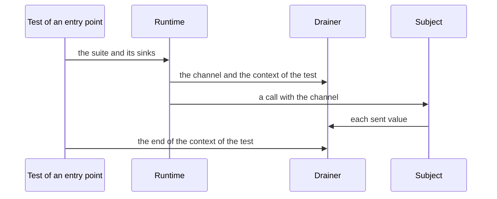

<!--
  ~ Copyright Dokimasia B.V. 2026
  ~ SPDX-License-Identifier: Apache-2.0
-->

# RFC-0007: The value of every type in the inputs of a suite

## Summary

The suite generator gives every type in the inputs of a callable a generator, at every position of the inputs. A property run, a budget, a fuzz target or a benchmark then does not fail before its first case for lack of a generator, and a generated value does not block a subject. The property engine generates data, and its Go reader gains three kinds. The suite generates functions, interfaces, channels, errors, contexts and values without a readable field. One classifier in the suite generator returns the generator of each type. A spec over every kind of `reflect` proves that the classifier covers each kind. A finding at generation time reports each type that the classifier cannot give a generator.

## Motivation

A suite draws the inputs of a callable before each call. It draws each parameter and each exported field at every depth. It also draws the results of every method of each interface that an input contains, whether the subject calls the method or not. The suite overrides enumerations, structs with a starting value, function types, interfaces outside the standard library and `any`. The shape reader of the property engine reads every other type. A type that the reader refuses fails the draw, so each property run, budget, fuzz target and benchmark of the callable fails before its first case.

dokimasia/dokimi#30 reports the failure in sharder. The input of a placer contains a clock, and the clock returns timers. A timer returns `<-chan time.Time`. The suite draws the results of the method `C` of each timer, the reader refuses the channel, and every run of `Place` fails. The placer reads only the time of the clock.

A probe of `prop.ShapeOf` on assert-go v0.8.0 shows the types that the reader refuses:

| Type | Refusal |
|---|---|
| `uintptr`, `complex64`, `complex128`, `unsafe.Pointer` | `uintptr is no type that a shape states` |
| `chan T`, `<-chan T`, `chan<- T`, and an array of channels | `chan int is no type that a shape states` |
| A function type | `func() is no type that a shape states` |
| An interface without registered variants, such as `error`, `io.Reader`, `fmt.Stringer` and `any`, also as a map key | `error has no variants, which RegisterVariants states` |
| A struct without an exported field, such as `struct{}`, `strings.Builder`, `sync.Mutex` and `os.File` | `os.File has no exported field to read` |
| A struct with a field of a refused type, such as `time.Timer` | `Timer.C: <-chan time.Time is no type that a shape states` |
| A struct with two fields of one JSON name | `the fields A and B are both named "x"` |
| A `*big.Rat` without a `scale` tag | `a *big.Rat reads as a decimal, which needs the tag key scale` |

The reader reads recursive structs, generic structs at their type arguments, `*big.Int` and `*time.Location`.

Today a type that the reader refuses takes the generator of a registration of the test process. A registration applies to the whole test binary, and a second registration of one type panics. Kits that share a test binary cannot both register a type. A consumer cannot register a type of an internal package of another tree either. A parameter takes no tag, so a callable that takes a `*big.Rat` does not get a case without a registration.

A zero value breaks a channel and an interface. A receive from a nil channel blocks forever, and a case cancels its context only after its body ends. So a subject that waits on a nil channel hangs its run until the timeout of `go test`, and the run does not report a counterexample. A call of a method of a nil interface panics in the subject, and the failure then looks like a defect of the subject.

The fix belongs in the suite generator, with three kinds in the property engine. The engine reads types through `reflect`. Go cannot implement an interface at run time, and the engine does not see declarations, so the engine generates neither an interface nor its implementations. The suite generator reads the declarations of eidos and writes code. A value with a language-neutral shape belongs in the engine instead. Every caller of `prop.Of` then gains it, and every language draws the same values of it from a seed.

## Detailed design

### Invariants

| Invariant | Enforced by |
|---|---|
| Every type in the inputs of a callable has a generator. A run does not fail before its first case for lack of one | The classifier, and the finding `Ungenerated` for each type without a generator |
| A receive from a channel that the suite generates returns, and so does a send to a sink | Streams, sinks and the end values of generated functions |
| A type takes one generator at every position: a parameter, a field, an element, a map key or value, a type argument and a result of a generated function | One override for each type through `prop.Using` |
| Where every value fails some use, the suite takes the value whose misuse fails at once with a counterexample | A send to a stream panics at once |
| A generated implementation of an interface is comparable and hashable | The template returns the address of each implementation |
| A value with a shape takes the same values from a seed in every language | The engine generates every type that a shape states |

### Components

| Component | Repository | Change |
|---|---|---|
| The classifier | dokimi | One function returns the generator of a type. The parameters, the results of generated functions and the walk of the overrides take their generators from it |
| The overrides | dokimi | Streams, sinks, `error`, `context.Context`, `unsafe.Pointer`, the interfaces of the package `io`, interfaces with an unexported method, structs without a readable field, and four types of the standard library |
| The templates | dokimi | The new overrides in `Using`, the field `Sinks`, the end values of channel results, and the address of each generated implementation |
| The finding `Ungenerated` | dokimi | `DOKIMISUITE-0010`, a Warning at the declaration |
| The runtime | conform | `Stream`, `Closed`, `Sink`, `SinkOf`, `Bytes`, `NewBytes`, and the field `Sinks` of `Suite` |
| The Go reader | assert-spec, assert-go | `uintptr`, the complex types and a `*big.Rat` without a `scale`, which dokimasia/assert-spec#24 requests |

### The generator of each type

| Type | Generator | Layer |
|---|---|---|
| `bool`, the sized integers, floats, `string`, bytes, slices, arrays, maps, pointers, structs with a readable field, `time.Time`, `time.Duration`, `*time.Location`, `uuid.UUID`, `netip.Addr`, `*big.Int` | The shape reader. It reads the parts of a struct, a slice, a map or a pointer with the overrides of the run in place | Engine |
| `uintptr` | An unsigned integer of its width | Engine |
| `complex64`, `complex128` | A record of a real and an imaginary float, each of half the width | Engine |
| `*big.Rat` without a `scale` tag | A fraction of a signed numerator and a denominator from 1 | Engine |
| An enumeration | One of its members | dokimi |
| A struct with a sample, a builder or declared defaults | Its starting value, with each readable field kept or changed | dokimi |
| A struct without a readable field that the file of the suite can import | Its zero value. This covers a struct of the standard library, a generic struct at its type arguments and `struct{}` | dokimi |
| `*slog.Logger`, `*log.Logger`, `*bufio.Reader`, `*bufio.Writer` | A logger that discards its output, a reader over drawn bytes, or a writer into `io.Discard` | dokimi |
| A function type | A generated function | dokimi |
| An interface whose methods are all exported | A generated implementation, also for an interface of the standard library | dokimi |
| An interface of the package `io` whose methods `*conform.Bytes` has | A `*conform.Bytes` over drawn bytes | dokimi |
| `error` outside the results of a generated function | nil or `conform.ErrGenerated` | dokimi |
| `context.Context` outside the role context | `context.Background()` | dokimi |
| An interface with an unexported method, outside the standard library | One of the implementations that its package exports and the file of the suite can import | dokimi |
| `any` | A string, an int or a bool | dokimi |
| `<-chan T` and `chan T` | A stream: a closed channel with a drawn list of elements in its buffer | dokimi, conform |
| A parameter `<-chan T` that the callable receives from | A closed channel of a drawn list, which each call builds | dokimi |
| `chan<- T` | The sink of the test | dokimi, conform |
| `unsafe.Pointer` | nil | dokimi |
| An interface of the standard library with an unexported method, such as `testing.TB` | None: `Ungenerated` | dokimi |
| An interface with an unexported method whose package exports no implementation that the file can import | None: `Ungenerated` | dokimi |
| A struct with two fields of one JSON name | None: `Ungenerated` | dokimi |
| A type of a kind that the engine refuses, whose generated code refers to a declaration that the file cannot import | None: `Ungenerated` | dokimi |

### Channels

The suite builds each channel, and the property engine generates its elements. A channel takes its value by its direction.

- **Streams.** A receive channel `<-chan T` and a bidirectional channel `chan T` take a stream. A stream is a closed channel with a drawn list of elements in its buffer. Each receive returns the next element, and the receive after the last element reports that the channel is closed. So a receive never blocks, and a loop over the channel ends. A failure shrinks towards a stream without elements. A send to a stream panics at once, so a subject that sends to a bidirectional channel fails its case with a counterexample.
- **Sinks.** A send channel `chan<- T` takes the sink of its test. Each entry point of the runtime makes one channel of each such type for its test. A goroutine receives and drops each value that a subject sends, until the context of the test ends. The runtime does not close the channel, so a send after the end of the test blocks its goroutine instead of panicking.
- **End values.** A generated function returns the drawn values of each result, one value for each call. After the last of them, it returns a closed channel without elements for a receive or a bidirectional channel result, and the sink of its test for a send channel result. An error result returns its end error, and any other result its zero value. The function takes its end values when the case draws it, outside the measured call. The base of a recursive interface or function type returns the same end values.
- **Receive parameters.** A parameter that the callable receives from keeps its closed channel of a drawn list, which each call builds.

#### Streams in place of nil channels

- A receive from a nil channel blocks forever. A case cancels its context only after its body ends, so a subject that waits on such a channel hangs its run until the timeout of `go test`.
- The results of a generated function end with an end error, so that a caller that reads until an error stops. For a caller that reads until the channel closes, a closed channel is the same end.
- A receive parameter already takes a closed channel of a drawn list.

A closed `Done() <-chan struct{}` reports that its work is done. A correct subject can then stop, and a claim of its callable can fail. The counterexample shows the closed channel. The application then states nil for the type through `conform.Using`.

#### The lifetime of a sink

A benchmark draws its 100 calls with `prop.Values`. Each case of `Values` cancels its context once it has decoded its value, so a sink that a case drained would stop before the benchmark sends. So each sink lasts as long as its test.



conform declares the streams, the end values and the sinks:

```go
// Stream returns the generator of the channel type C whose values are
// streams. Each stream is a closed channel with a list of elements in its
// buffer, which elements generates. Its receives return the elements in order
// and then report that the channel is closed, so they never block. A failure
// shrinks towards a stream without elements.
func Stream[C ~<-chan T | ~chan T, T any](elements prop.Generator[T]) prop.Generator[C]

// Closed returns a closed channel of the type C without elements. A generated
// function returns it for a channel result after its last drawn values.
func Closed[C ~<-chan T | ~chan T, T any]() C

// Sink is a send channel type that the inputs of a suite contain. Each entry
// point of the runtime makes one channel of the type for its test, and states
// the channel as the generator of the type in every run of the test. A
// goroutine receives and drops each value that a subject sends, until the
// context of the test ends. The runtime does not close the channel, so a send
// after the end of the test blocks the goroutine that sends.
type Sink struct {
	// open makes the channel for the test of ctx and starts the goroutine
	// that drains it until ctx ends. It returns the option that states the
	// channel.
	open func(ctx context.Context) prop.Option
}

// SinkOf returns the sink of the send channel type C.
func SinkOf[C ~chan<- T, T any]() Sink
```

`Suite` gains one field:

```go
type Suite[S any] struct {
	// Declaration, Checks, Calls and Using keep their meaning.

	// Sinks are the send channel types that the inputs of the calls of the
	// suite contain. Run, RunBudgets, Falsify, FalsifyAllocs, Fuzz, Bench and
	// BenchParallel each open every sink on the context of their test. They
	// pass the channel of each sink after the overrides of Using and before
	// the generators of the option Using, so the option replaces a sink.
	Sinks []Sink
}
```

### Errors, contexts and pointers

- `error` takes nil or `conform.ErrGenerated` through `prop.Using(prop.SampledFrom[error](nil, conform.ErrGenerated))`. These are the values of an error result without declared errors. The results of a generated function keep their declared errors.
- `context.Context` outside the role context takes `context.Background()`. A subject that waits for the end of such a context blocks, as it does for the context of the call.
- `unsafe.Pointer` takes nil.

### Interfaces

An interface whose methods are all exported takes a generated implementation, also when it is an interface of the standard library. eidos loads the signatures of the standard library as dependency units, so the suite reads their methods as it reads the methods of the workspace. Each method returns one set of its drawn results for each call, and then its end values.

The template returns the address of each implementation. The implementation is a struct with a field of a function type for each method, and Go neither compares nor hashes such a struct. A map key of an interface type, or `==` on two values of an interface, would then panic. A pointer is comparable and hashable.

An interface of the package `io` whose methods `*conform.Bytes` has takes a `*conform.Bytes` over drawn bytes. A generated `Read` returns a drawn count without writing into the buffer, which breaks the contract of `io.Reader`. The covered interfaces are `Reader`, `ReaderAt`, `ByteReader`, `ByteScanner`, `RuneReader`, `RuneScanner`, `Seeker`, `ReadSeeker`, `ReadCloser`, `ReadSeekCloser`, `WriterTo`, `Writer`, `StringWriter`, `ByteWriter`, `WriteCloser`, `WriteSeeker`, `ReadWriter`, `ReadWriteCloser`, `ReadWriteSeeker` and `Closer`. Any other interface of `io`, such as `ReaderFrom`, takes a generated implementation.

```go
// Bytes is a value of the interfaces of package io over a byte slice. The
// methods of its embedded bytes.Reader read the bytes: Read, ReadAt,
// ReadByte, ReadRune, Seek and WriteTo. Write, WriteString and WriteByte
// discard their input and report it as written, and Close returns nil. The
// zero Bytes has no bytes.
type Bytes struct {
	bytes.Reader
}

// NewBytes returns a *Bytes over p.
func NewBytes(p []byte) *Bytes
```

The suite writes the generator of each such interface with the interface as its type, so the compiler checks that `*conform.Bytes` implements the interface:

```go
prop.Using(prop.Composite(func(c *prop.Case) io.ReadCloser {
	return conform.NewBytes(c.Draw(prop.Of[[]byte](), "body"))
})),
```

An interface with an unexported method is sealed: Go code outside its package cannot implement it. A generated implementation would embed the interface, and a call of the unexported method would panic. `Bound.Implementers` of eidos lists the declarations whose members satisfy the interface. The suite draws one of the implementations that the package of the interface exports and that the file of the suite can import, each through the engine:

```go
prop.Using(prop.OneOf(
	prop.Composite(func(c *prop.Case) shape.Shape { return c.Draw(prop.Of[shape.Circle](), "circle") }),
	prop.Composite(func(c *prop.Case) shape.Shape { return c.Draw(prop.Of[shape.Square](), "square") }),
)),
```

An interface of the standard library with an unexported method, such as `testing.TB` or `reflect.Type`, has no implementation that a test can build, so the suite reports `Ungenerated`.

### Values without a readable field

A struct without a readable field takes its zero value wherever the file of the suite can import it. This covers a struct of the standard library, a generic struct at its type arguments and `struct{}`. Code outside the package of such a struct builds no other value without a constructor. A pointer to such a struct follows the engine, which draws nil or the address of the zero value.

These types of the standard library take a value of a constructor instead:

| Type | Value | The zero value and nil |
|---|---|---|
| `*slog.Logger` | `slog.New(slog.DiscardHandler)` | `Enabled` calls the nil handler |
| `*log.Logger` | `log.New(io.Discard, "", 0)` | A log call writes to the nil writer |
| `*bufio.Reader` | `bufio.NewReader` over drawn bytes | `Read` calls the nil reader |
| `*bufio.Writer` | `bufio.NewWriter(io.Discard)` | `Write` calls the nil writer |

A type gets a row when its zero value and nil both make a correct subject fail at its first use. A constructor of the standard library must also build a value that does not use a file, a socket or a process.

### The classifier

One function returns the generator of each type. It reads the form of the type, and for a named type the kind of its declaration:

```go
// source is the generator of the values of one type in the inputs of a
// suite.
type source uint8

const (
	// sourceEngine is the shape reader of the property engine.
	sourceEngine source = iota
	// sourceMembers draws one member of an enumeration.
	sourceMembers
	// sourceStart starts from a sample, the value of a builder, declared
	// defaults or the zero value, and keeps or changes each readable field.
	sourceStart
	// sourceGenerated is a generated function or a generated implementation.
	sourceGenerated
	// sourceVariants draws one implementation of an interface with an
	// unexported method.
	sourceVariants
	// sourceStream is conform.Stream.
	sourceStream
	// sourceSink is the sink of the test.
	sourceSink
	// sourceBytes is a *conform.Bytes over drawn bytes, alone or as the
	// reader of a constructor of the standard library.
	sourceBytes
	// sourceConstant is one fixed value: nil, context.Background() or the
	// value of a constructor of the standard library.
	sourceConstant
	// sourceError draws nil or conform.ErrGenerated.
	sourceError
	// sourceDynamic draws a string, an int or a bool.
	sourceDynamic
	// sourceNone is no generator, and the suite reports Ungenerated.
	sourceNone
)

// sourceOf returns the generator of the values of the type ref at its type
// arguments. For sourceNone it also returns the reason why no generator of
// the suite covers the type, as a sentence. A list, an array and a map take
// the shape reader, and the walk of the overrides enters their parts.
func (k *caller) sourceOf(ref *node.TypeRef) (source, string)
```

`params`, `result` and the walk of the overrides call `sourceOf`. The walk records one override for each type that it meets, except a type whose source is `sourceEngine` or `sourceNone`. It reports `Ungenerated` for each type whose source is `sourceNone`. The walk does not enter a type that the shape reader reads as a shape of its own, such as `time.Time`, so no override replaces a part of such a shape.

### The finding

```go
// Ungenerated reports a type in the inputs of a callable that no generator of
// the suite covers. An interface with an unexported method is such a type when
// the standard library declares it, or when its package does not export an
// implementation that the file of the suite can import. A struct with two
// fields of one JSON name is such a type. So is a type of a kind that the
// property engine refuses, when its generated code refers to a declaration
// that the file cannot import. Each run of the callable fails before its first
// case until the test process registers a generator of the type. The finding
// is a Warning at the declaration, and suite records the suite of the
// declaration.
var Ungenerated = diag.MustRegister(CodePrefix, diag.CodeSpec{
	Number:  10,
	Meaning: "a type in the inputs of a callable of a declaration under the directive suite has no generator",
})
```

The finding reports the callable, the path from the parameter to the type, the reason and the remedy. A consumer that registers a generator of the type suppresses the finding at the declaration with `//dokimi:diag off=DOKIMISUITE-0010`.

### The engine

The Go reader of the property engine reads three more kinds:

- `uintptr` as an unsigned integer of its width
- `complex64` and `complex128` as a record of the fields `real` and `imag`, each a float of half the width
- a `*big.Rat` without a `scale` tag as a record of a signed 64-bit numerator and an unsigned 64-bit denominator from 1, in lowest terms

The classifier gives these kinds to the engine, so the suite does not write an override for them.

### Generated code

The suite of the reproduction of dokimasia/dokimi#30 overrides `Timer` and the channel of its method. A declaration with a send channel in its inputs also states its sink:

```go
Using: []prop.Option{
	prop.Using(prop.Composite(func(c *prop.Case) timers.Timer {
		timerCResults := c.Draw(prop.List(prop.Of[<-chan time.Time]()), "timer-c")
		timerCEnd := conform.Closed[<-chan time.Time]()
		var timerCAt atomic.Int64
		return &runnerTimerInput{
			onC: func() (r0 <-chan time.Time) {
				i := int(timerCAt.Add(1) - 1)
				if i >= len(timerCResults) {
					r0 = timerCEnd
					return
				}
				return timerCResults[i]
			},
		}
	})),
	prop.Using(conform.Stream[<-chan time.Time](prop.Of[time.Time]())),
},
Sinks: []conform.Sink{
	conform.SinkOf[chan<- string](),
},
```

### Bounds

| Quantity | Bound | Measured |
|---|---|---|
| A stream | One channel with a buffer of its list. The case makes it when it draws the stream, outside the measured call | 1 allocation and 192 B for 10 integers, and about 290 ns to build and drain |
| A send to a sink | No allocation | 120 to 150 ns |
| A sink | One channel and one goroutine for each send channel type, for each test of an entry point | 11 allocations and 784 B to open, with the context and the option |
| The goroutines of the sinks | The number of send channel types of the suite, for each running test | — |
| The classifier | One decision for each type that the walk meets, in place of the decisions that it replaces | — |

The measurements ran on an AMD Ryzen 9 9950X3D with Go 1.27.3.

### Failure handling

| Failure | Result | Recovery |
|---|---|---|
| A subject sends to a stream | The send panics, and the case fails with a counterexample that shows the channel | The application states a channel through `conform.Using` |
| A claim fails on a stream that the subject reads as a signal, such as `Done` | The counterexample shows the closed channel | The application states nil through `conform.Using` |
| A subject sends to a sink after its test has ended | The goroutine of the subject blocks | Stop the goroutines of the subject when its call returns |
| A generated implementation of an interface of the standard library breaks the contract of the interface | A check fails, and the counterexample shows the drawn results | The application states a value through `conform.Using` |
| A zero value is not a valid input of the subject | A check fails, and the counterexample shows the zero value | The application states a value through `conform.Using` |
| A type has no generator | `Ungenerated` at the declaration, and each run of the callable fails before its first case | A registration of the test process, and the suppression of the finding |
| The engine refuses `uintptr`, a complex type or a `*big.Rat` without a `scale` | Each run of the callable fails before its first case | `conform.Using`, or the engine that reads the kind |
| The classifier meets a type that no rule covers, such as a type outside the view | The type takes the shape reader, which reads it or refuses it in the first run | A registration of the test process, or a rule of dokimi |

### Verification

- **The classifier.** A spec enumerates the kinds of `reflect` from `Bool` to `UnsafePointer` and each position, and fails for a kind without a generator. The list of kinds comes from `reflect`, not from a table in the spec.
- **The corpus.** A fixture has a parameter, a field, an element and an input result of every kind, a function type, a map key of an interface type, a sealed interface and channels of each direction. Its generated property runs, budgets, fuzz targets and benchmarks pass against its control in memory. It contains the reproduction of dokimasia/dokimi#30.
- **Liveness.** A spec in a `testing/synctest` bubble runs a subject that loops over each stream and sends 1,000 values to each sink. A blocked subject fails the bubble at once.
- **conform.** Specs of `Stream` and `Closed` end every receive. A spec of a sink runs a benchmark in a `testing/synctest` bubble, which fails when a send blocks or when the goroutine of the sink outlives the test. `testing/iotest.TestReader` checks the contract of `io.Reader` on a value of `NewBytes`.
- **The goldens.** The 10 suites of this repository that declare an implementation of an input interface regenerate, and so do the 2 suites that start a struct without a readable field. Their diffs are reviewed.

### Migration

- A regenerated suite changes in four places: the overrides, the field `Sinks`, the end values of channel results, and the address of each implementation.
- conform gains its new API in a minor release, and a regenerated suite requires that release.
- A registration of a type that the suite now overrides no longer applies in the runs of the suite, because `prop.Using` takes precedence over a registration. The application states the generator through `conform.Using`.
- The suite does not change when assert-go releases the three readings.

### Requests

| Project | Request | Why |
|---|---|---|
| assert-spec | The Go reader reads `uintptr`, `complex64`, `complex128` and a `*big.Rat` without a `scale` ([dokimasia/assert-spec#24](https://github.com/dokimasia/assert-spec/issues/24)) | A callable that takes one of them at any depth gets cases without a registration, and every language that reads the same record draws the same values |
| eidos | A dependency unit lists the unexported methods of an exported interface ([dokimasia/eidos#90](https://github.com/dokimasia/eidos/issues/90)) | The suite reports `Ungenerated` for an interface of the standard library with an unexported method, such as `testing.TB`, and generates no implementation of it |

### Capabilities

| Capability | Verdict | Reason | Reverses when |
|---|---|---|---|
| Streams for receive and bidirectional channels | In | A receive never blocks, and a loop over a channel ends | — |
| Sinks for send channels, one for each test | In | A send never blocks while the test runs, in a property run, a fuzz target and a benchmark | — |
| A sink for a bidirectional channel | Out | A receive from a sink blocks | A subject that both sends to and receives from a channel of its input |
| Nil channels | Out | A receive or a send blocks forever | — |
| A record of the values that a subject sends to a sink | Out | No check reads them | A claim about the values that a callable sends |
| Generated implementations of the interfaces of the standard library | In | Their methods return drawn results, as the methods of the workspace do | — |
| `conform.Bytes` for the interfaces of `io` | In | A generated `Read` breaks the contract of `io.Reader` | — |
| The io value for an interface of the workspace with the signatures of an io interface | Out | The contract of an interface of the workspace is its author's | An interface that documents the contract of `io.Reader` |
| Implementations of a sealed interface | In | The package of the interface declares its values | — |
| Zero values for every struct without a readable field | In | Code outside the package builds no other value without a constructor | — |
| Constructors for four types of the standard library | In | Their zero value and nil both fail at the first use | — |
| `uintptr`, complex types and fractions in the engine | In, in assert-go | Data with a shape belongs in the engine | — |
| A zero value inside the engine for every refused type | Out | Every language would need a new level of precedence | — |
| `Ungenerated` for a type without a generator | In | The consumer learns of the gap at generation time, not in the first run | — |
| The address of each generated implementation | In | A struct of function fields panics as a map key and under `==` | — |

## Alternatives considered

### The zero value of every refused type

The suite overrides each type that the reader refuses with its zero value. A struct without an exported field takes its zero value in the same way.

**Why not:** a receive from a nil channel and a send to it block forever. A subject that uses such a channel hangs its run without a counterexample. A call of a method of a nil interface panics in the subject, and the failure then looks like a defect of the subject.

### A stream shape in the property engine

The reading table of assert-spec gains a stream shape. The Go reader reads a channel as a stream, and every caller of `prop.Of` gains channels.

**Why not:** a channel delivers data and is not data, so a shape does not state how a subject uses it. The reading table lists channels among the types that Go does not read. The suite already builds the channel of a receive parameter from a drawn list, and the engine still generates the elements of each stream.

### A zero value inside the engine

The engine takes the zero value of a type that it refuses, below `using` and the registrations.

**Why not:** every language of assert-spec would need a new level of precedence. The values of an interface would still be nil.

### A sink that a case drains

The generator of a sink starts a goroutine that drains the channel until the context of the case ends.

**Why not:** a benchmark draws its calls with `prop.Values`, and each case of `Values` cancels its context once it has decoded its value. The goroutine would stop before the benchmark sends, and the benchmark would hang.

### A buffered channel as a sink

A sink is a channel with a buffer of a fixed size, and no goroutine drains it.

**Why not:** a benchmark repeats its calls until the benchmark contract stops it. Its sends fill any buffer, and the next send blocks.

### A sink that each call builds

The call generator builds a sink for each call and stops its goroutine when the call returns, as it builds the channel of a receive parameter.

**Why not:** the call measures the sink. An allocation ceiling and a benchmark of the callable would count the goroutine, the channel and the context of each call.

### Draws at the first call of a generated method

A generated method draws its results at its first call, so a method that the subject never calls draws nothing.

**Why not:** the draws of a case would then depend on the calls of the subject. A call from another goroutine already makes a run flaky.

### A registration of each type

Each suite package registers a generator of each refused type in an `init` function.

**Why not:** a second registration of one type panics, so two kits of one test binary cannot both register it. A test cannot register a type of an internal package of another tree.

### Generated implementations of the interfaces of `io`

The interfaces of `io` take generated implementations, as other interfaces do.

**Why not:** a generated `Read` returns a drawn count without writing into the buffer, and a generated `Write` reports a drawn count. A correct subject that relies on the contract of the interface then fails.

## Drawbacks

- **The runtime.** conform gains six exported names, `Stream`, `Closed`, `Sink`, `SinkOf`, `Bytes` and `NewBytes`, and the field `Sinks` of `Suite`.
- **Generated code.** The 10 suites of this repository that declare an implementation of an input interface change, and so do the 2 suites that start a struct without a readable field and each suite of a consumer.
- **Values that the domain does not accept.** A value is valid for its type but not always for the subject, such as a closed `Done` channel or an empty reader. A claim then fails until the application states another value through `conform.Using`.
- **Goroutines.** Each test of an entry point runs one goroutine for each send channel type of its suite. Each goroutine ends with its test.
- **Registrations.** A registration of a type that the suite now overrides no longer applies in the runs of the suite.
- **Upkeep.** The constructors of the standard library and the list of the interfaces of `io` change when Go adds a type of the same contract.
- **The engine.** `uintptr`, the complex types and a `*big.Rat` without a `scale` keep failing until assert-go reads them.
- **Benchmarks of receives.** A benchmark repeats its drawn calls, so each repetition after the first receives from a stream that the first repetition drained.

## Open questions

None.

## Unresolved and future work

- This proposal covers the Go target. The TypeScript suites have no generator yet, and their values are not proposed here.
- A sink that records the values that a subject sends is not proposed here.
- An interface of the workspace with the method set of an io interface takes a generated implementation. A rule that gives it a `*conform.Bytes` is not proposed here.

## References

| What | Where |
|---|---|
| dokimasia/dokimi#30, a method of an input that returns a channel | <https://github.com/dokimasia/dokimi/issues/30> |
| dokimasia/assert-spec#24, the three readings of the Go reader | <https://github.com/dokimasia/assert-spec/issues/24> |
| dokimasia/eidos#90, the unexported methods of an interface of a dependency unit | <https://github.com/dokimasia/eidos/issues/90> |
| The reading table of assert-spec, and its rule that a decimal states its scale | <https://github.com/dokimasia/assert-spec/blob/main/docs/rfc/0011-property-forms-and-derived-inputs.md> |
| The shape reader of assert-go, whose cases refuse the kinds of the probe | <https://github.com/dokimasia/assert-go/blob/main/prop/reader.go> |
| The members that eidos lists for an interface, `Bound.Implementers` | <https://github.com/dokimasia/eidos/blob/main/eidos-core/rules/satisfy.go> |
| The comparison operators of Go, under which a struct with a field of a function type is not comparable | <https://go.dev/ref/spec#Comparison_operators> |
| The contract of `context.Context`, whose `Done` may return nil | <https://pkg.go.dev/context#Context> |
| The contract of `io.Reader` | <https://pkg.go.dev/io#Reader> |
| `testing/iotest.TestReader` | <https://pkg.go.dev/testing/iotest#TestReader> |
| `testing/synctest` | <https://pkg.go.dev/testing/synctest> |
| `slog.DiscardHandler` | <https://pkg.go.dev/log/slog#DiscardHandler> |
| `testing/quick`, which builds a complex value from two floats | <https://github.com/golang/go/blob/go1.27.3/src/testing/quick/quick.go#L79-L104> |
| gofuzz, which fills `uintptr` and the complex types | <https://github.com/google/gofuzz/blob/v1.2.0/fuzz.go#L463-L489> |
| rapid, whose `Make` generates `uintptr` and refuses channels, functions and interfaces | <https://github.com/flyingmutant/rapid/blob/v1.3.0/make.go#L98-L139> |
