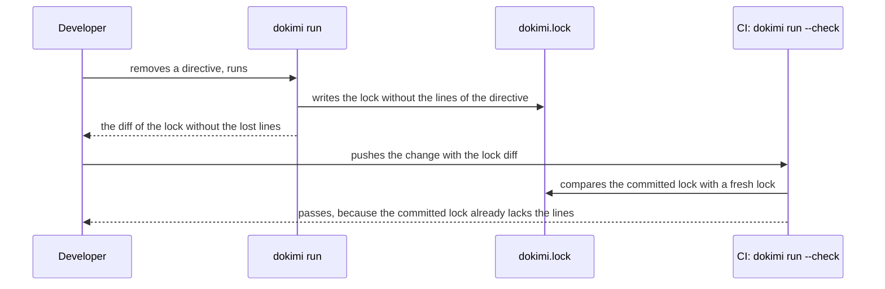

<!--
  ~ Copyright Dokimasia B.V. 2026
  ~ SPDX-License-Identifier: Apache-2.0
-->

# RFC-0013: The lock of check identities

## Summary

Each run of dokimi writes one lock for each plan that runs the suite generator: a committed text file with one line for each check, each ceiling, each refusal and each unclaimed classification of the suites of the plan, with the claim, the status and the partners of each. The lock of the plan go is `dokimi.go.lock` at the root of the workspace. The lock is a line-set data family of eidos. `dokimi run --check` passes each line of the committed lock that the fresh lock lacks to the suite generator, which reports a lost check, a lost ceiling or a check bound to other partners as the finding `LostCheck`. A removal is approved in review, through the diff of the lock in the same change. The lock replaces the lock of RFC-0003, a source file per package that lists the keys of its checks.

## Motivation

A gate can prove that each surviving check can fail. It cannot prove that a check did not disappear. A consumer removes a directive or renames a callable, regenerates, and the checks that the directive licensed vanish. The suite remains green and asserts less.

RFC-0003 makes the loss visible as a deleted line in a small source file of each package, and the generation gate fails while that file differs from a fresh run. Three cases still pass without a word:

- **A check that becomes a refusal.** A consumer deletes the samples that a check needs, and the claim refuses. A lock of checks alone loses the line of the check, and no line states the refusal.
- **A check that binds another partner.** A rename of `Put` to `PutAll` can move the partner of `Read/read-after-write` to another callable. The key of the check is the same, so a lock of keys does not change.
- **A failure without a name.** The generation gate reports each file that a fresh run would change. It names the file of the lock and not the check that the change loses.

eidos gives a generator both mechanisms that a named finding needs. A data family has a fixed file name, one file per plan and a template that writes the whole file without a header, a frame or a format step (`plugin.Output.Name`). A line-set family is a data family whose file `run --check` compares line by line, and it passes each removed line to the generator through `plugin.LineSetReader` (`eidos-core/plugin/emit.go:57-113`). eidos offers line sets for data families alone, so the lock is a data file per plan.

The protobuf conformance runner fails on each change of its committed failure lists, in both directions, and names the test (`conformance/conformance_test.cc`). buf turns the removal of a field into the finding `FIELD_NO_DELETE`.

## Detailed design

### The lock

The suite generator writes the lines of every suite of a plan into one lock of the plan. The composition of dokimi places the lock at the root of the workspace and names it after the plan, as `dokimi.go.lock` for the plan go. A layout in `.dokimi.yaml` can move or rename it. One root contains the files of every plan of a workspace, so a lock without the name of its plan would collide with the lock of a second plan that runs the suite generator. The TypeScript plan does not run the suite generator and has no lock.

Each line is a record without an origin. The layout routes a record by the `out` directive of its origin, so a line whose origin is a suite declaration with `out` would land beside the files of that suite. A record without an origin has no override, so every line stays in the one lock of its plan.

```text
# dokimi lock 1
# Each line is one check, ceiling, refusal or unclaimed classification. Commit this file.
example.com/shop/catalog	store.get/allocation-budget	allocation-budget	ceiling	-
example.com/shop/catalog	store.get/cancel	cancel	check	-
example.com/shop/catalog	store.get/zero-on-error	zero-on-error	check	-
example.com/shop/catalog	store.put	mixin:concurrent	needs	-
example.com/shop/catalog	store.read/keeps-the-item	keeps-the-item	authored	-
example.com/shop/catalog	store.read/read-after-write	read-after-write	check	write=store.put
example.com/shop/catalog	store.scan/zero-on-error	zero-on-error	refused	-
```

| Field | Value |
|---|---|
| package | The import path of the package or the module path of the subject |
| key | The key form of the check identity, or of the callable for an unclaimed classification |
| claim | The identifier of the claim in the conformance spec, the segment of a check of the consumer or of a ceiling, or the classification of an unclaimed line, such as `mixin:concurrent` |
| status | `check` for a derived check, `authored` for a check of the directive `check`, `ceiling` for a ceiling of a budget, `refused` for a refusal, and the stance for an unclaimed classification |
| partners | Each partner of the check as `<name>=<key of the callable>`, joined by commas in the order of the names, or `-` when the check has none |

The lines are sorted by package and key. A line contains no timestamp and no version of the binary, so a run without a change of the source writes the same bytes. The key form is the same in every language, so the locks of two plans of one declaration have the same lines where the two languages agree.

A generated binding is a derived check, so its line has the status `check` and the key of its identity, such as `store.get/zero-on-error#generated`. The test of a suite adds checks such as `builds-the-subject` to the forms of its application. Those checks test the generated suite and claim nothing of the declaration, so the lock leaves them out. The tests of the generators `enum` and `sentinel` are fixed templates without claims, and a family of eidos belongs to the one generator that declares it. The lock leaves those tests out too, and a lost test of an enumeration or an error shows in the diff as a deleted test file.

### The family

The suite generator declares the family of the lock:

```go
// The lock is one data file per plan, which run --check compares line by
// line.
plugin.Output{
	Tag:      "lock",
	Per:      plugin.PerPlan,
	Word:     "lock",
	Name:     "dokimi.lock",
	LineSet:  true,
	Template: "lock.tmpl",
}
```

eidos refuses a per-plan family without a directory, so the composition gives the family a directory and a file name in each plan that runs the suite generator:

```go
layout.Config{Families: map[layout.Family]layout.Refinement{
	{Plugin: suite.ID, Tag: "lock"}: {Dir: ".", File: "dokimi.go.lock"},
}}
```

The layout writes the file name as given, without a word of the target (`eidos-core/layout/route.go:613-628`). A composition that refines neither field gets the error of the missing directory. A layout of `.dokimi.yaml` refines the directory and the name over the composition.

### The finding

The suite generator implements `plugin.LineSetReader` through the builder of its plugin, which takes the function as `Removed`:

```go
// lost returns LostCheck for a removed line of the lock whose status is
// check, authored or ceiling, and false for a line of a refusal, of an
// unclaimed classification or of the header, whose diff shows in review.
func lost(r plugin.RemovedLine) (diag.Diag, bool)
```

| Finding | Severity | Reported when |
|---|---|---|
| `LostCheck` | Error under `--check` | A committed line with the status `check`, `authored` or `ceiling` is absent from the fresh lock |

A check that the fresh run refuses, lists as unclaimed or binds to another partner has a line that differs from the committed line, so the committed line is absent and `LostCheck` reports it. eidos sets the position of the finding to the line of the committed lock. The message contains the key, the claim and the package: `store.get/zero-on-error (zero-on-error) of example.com/shop/catalog is no longer generated as the lock states. Commit the regenerated lock to approve the change`. The code of the finding is `DOKIMISUITE-0012`. eidos compares the lines under `--check` alone (`eidos-core/workspace/close.go:224-226`). A plain `dokimi run` writes the fresh lock, and the developer sees each removed line in the diff of the lock before the commit. A removed line of a refusal or of an unclaimed classification does not report a finding of its own. The fresh lock still differs from the committed lock, so `--check` reports the lock as out of date, and so it does for a fresh lock that only adds lines.

A plan without a suite does not record a line, so it does not write a lock. eidos compares the lines of a lock that the fresh run writes, and a run that does not write the lock passes none of its lines to `Removed`. So the loss of the last suite of a plan does not report `LostCheck`. `--check` reports the committed lock under `EID-0064` as a file that the run would delete, and a plain run deletes it. The gate fails in both cases, and the diff of the deleted lock shows each lost line in review.

### Flow



A push without the regenerated lock fails CI with `LostCheck` for each key that the committed lock still lists.

### Migration

The first run of a release with the lock writes the lock of each plan that runs the suite generator. `--check` reports a lock that the consumer has not committed as out of date, as it reports every new generated file, so CI fails until the consumer commits the lock. The release notes tell each consumer to commit the new files. The lock of RFC-0003 was never built, so no consumer has a file to remove.

## Alternatives considered

### A source file per package

The lock is a generated source file of the target language in each package of a suite, as RFC-0003 designs it.

**Why not:** eidos compares the files of line-set families line by line, and a line-set family is a data family. A source file per package can report a loss only as a stale file, which names no check. One file per plan also puts every change of the checks of a repository in one diff.

### A manifest of identities inside the state ledger of eidos

eidos keeps a manifest of each generated file in its state ledger, which a run reads and writes. The identities could live there.

**Why not:** the state ledger is not reviewed. A removal approved by a change of the ledger is a removal that no reviewer sees.

### A tombstone for each removal

A removed check remains in the lock with the status `removed` and a reason, as Rust keeps a retired error code in its index.

**Why not:** a tombstone records history that the commit log already records, and the lock grows without a bound. No artifact refers to the identity of a removed check.

### A lock of keys alone

The lock lists the key of each check, as RFC-0003 designs it.

**Why not:** the law that a check with a partner witnesses depends on the partner, and a refusal is a check that the declaration lost. Neither shows in a list of keys.

### One lock of every generator

The generators `enum` and `sentinel` add the lines of their tests to the lock of the suite generator.

**Why not:** a family of eidos belongs to the one generator that declares it, and eidos withholds a data file that two generators write. The tests of both generators also have no claims and no identities to list.

### One file name for the lock of every plan

Each plan writes `dokimi.lock`, and a workspace whose plans share a root gives the family a directory per plan in its layout.

**Why not:** the default collides as soon as a second plan runs the suite generator, so such a workspace needs a layout before its first run. A name with the plan does not need a layout, and it tells a reviewer which plan lost a check.

## Drawbacks

- **One more committed file per plan.** A repository commits one lock for each plan that runs the suite generator.
- **Conflicts in the lock.** Two branches that add checks to one plan both change its lock. The lines are sorted, so most merges resolve without a conflict, and a conflict resolves by a fresh run.
- **No finding before the commit.** A plain run writes the lock without a finding, so a developer learns of a lost check from the diff of the lock or from `--check`.
- **A finding on every change of a partner.** A check whose partner changes reports `LostCheck` until the regenerated lock is committed.
- **No named finding for the last suite.** The loss of the last suite of a plan fails `--check` with the deleted lock under `EID-0064`, without the key of each lost check.

## Open questions

None.

## Unresolved and future work

- A lock of the doubles and the builders is not proposed. Those generators make no claims.
- A lock of the tests of enumerations and errors is not proposed. Those tests are fixed templates without claims.

## References

| What | Where |
|---|---|
| protobuf conformance runner, the failure list and its checks | <https://github.com/protocolbuffers/protobuf/blob/main/conformance/conformance_test.cc> |
| buf, breaking-change rules | <https://buf.build/docs/breaking/rules/> |
| eidos, data families and line sets | <https://github.com/dokimasia/eidos/blob/main/eidos-core/plugin/emit.go> |
| eidos, the request of a data family | <https://github.com/dokimasia/eidos/issues/98> |
| eidos, the request of a line-set family | <https://github.com/dokimasia/eidos/issues/99> |
