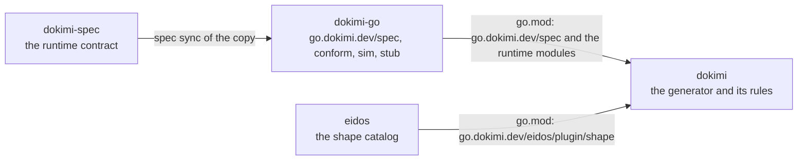

<!--
  ~ Copyright Dokimasia B.V. 2026
  ~ SPDX-License-Identifier: Apache-2.0
-->

# RFC-0034: The runtime contract and the rules of the generator

## Summary

dokimasia/dokimi-spec keeps the runtime contract of the conformance spec alone. The contract consists of the identifiers and the runtime meaning of the claims, laws, probes, reason codes, defect forms, machineries, gates and stances, with the check key and the suite record. Each language repository, such as dokimi-go, vendors the contract with `spec` and checks its runtime against it. The rules that derive checks from the classes of the eidos shape catalog move into dokimi, beside the code that evaluates them. dokimi reads the runtime contract through `go.dokimi.dev/spec` of dokimi-go, so the dependencies run in one direction: dokimi-spec, then dokimi-go, then dokimi.

## Motivation

One set of files contains two contracts:

| Contract | Readers | Vocabulary |
|---|---|---|
| The runtime contract | `conform`, `sim` and `stub` of dokimi-go, the generated suites, the report of dokimi | Identifiers of the spec, statements, reason codes, the record |
| The rules of the generator | The derivation of dokimi alone | The shapes, mixins, contracts and roles of the eidos shape catalog, and the facts that eidos stamps on a declaration |

The single set of files has these costs:

- **A runtime that reads the whole spec depends on eidos.** The type of a licence uses the types of the shape catalog, and the key of a check uses the casing of eidos. A package that reads the whole model compiles 32 packages outside the standard library, 29 of them from eidos. The package of dokimi-go compiles none, because it reads the identifiers and the probes alone. Every test binary of a consumer of dokimi would compile the 32 packages.
- **A rule of the generator is a release of the spec.** A new licence of a claim changes `claims.yaml`. Every language repository then syncs a copy whose runtime meaning did not change, and a language other than Go vendors classes of a catalog that it never reads.
- **A change of the spec runs the gate of dokimi.** The definition is a package of dokimi. Each edit of a YAML file runs the generator, the corpus and its conformance before a language repository can sync the change.

The split belongs at the definition, because the costs come from what its files contain. A language repository cannot ignore the rules while it vendors them. dokimi cannot change one of its rules without a release of another repository.

## Detailed design

### The dependency chain



dokimi-spec contains the definition, as assert-spec contains the definition of the assertions. Its files are the YAML sources of the runtime contract, their rendered JSON files and schemas, `naming.json`, the manifest and the renderer. Its `.spec.yaml` lists each language repository as an implementation. The renderer is a Go module of its own. Only dokimi-spec builds it, and it has no release.

The `.spec.yaml` of dokimi-go follows the main branch of dokimi-spec, as assert-go follows assert-spec. The job Spec checks the copy, and the nightly job proposes each newer copy as a pull request. The module `go.dokimi.dev/spec` embeds the copy and reads every file of it. It does not require a module of eidos.

dokimi requires `go.dokimi.dev/spec` and the runtime modules of dokimi-go. It has no copy of the spec and no `.spec.yaml`. The rules of the generator are files of dokimi, and its derivation joins each rule with the runtime entry of the same identifier.

### The split of each file

| File | Runtime contract in dokimi-spec | Rules of the generator in dokimi |
|---|---|---|
| `claims` | `id`, `statement`, `law`, `probe`, the `reason` and the `form` of `defect`, `machineries`, `since` | `generator`, `scope`, `licences`, `unless`, `gates`, `inputs`, `partners`, `entails`, the `clause` of `defect` |
| `laws` | `id`, `statement`, `since` | `depth`, `distinct-from` |
| `probes` | every field | none |
| `reasons` | every field | none |
| `defects` | `id`, `does`, `since` | `changes`, `min-steps` |
| `machineries` | every field | none |
| `gates` | `id`, `since` | `passes`, `why`, `remedy` |
| `stances` | `stances`: `id`, `meaning`, `closes`, `since` | `unclaimed`: each class of the shape catalog with its stance and note |
| `references` | none | every field |
| `keys` | every field | none |
| `schemas` | the schema of each file above, and the suite record | the schema of each rule file |

A generated suite records a refusal with its gate, and an unclaimed class with its stance. So the runtime contract keeps the identifier of each gate and stance. Only the derivation evaluates the texts of a gate and the stance of a class, so those are rules.

The reference forms and the depth of a law are rules too. No template of a generated file writes the identifier of a reference form, and no runtime reads the depth of a law. The derivation reads the depth to mark a shallow check, and the generator of fakes reads the roles and the state of a reference form.

### The runtime model of dokimi-go

`go.dokimi.dev/spec` keeps its constants and the functions `Probes`, `ProbeOf`, `Key` and `Version`. It gains the entries of the other files. Each kind of entry has a function for every entry in the order of its file, and a function for one entry by its identifier:

```go
// Claim is the runtime contract of a claim: its statement, its probe and
// its planted defect.
type Claim struct {
	ID          ClaimID       `json:"id"`
	Statement   string        `json:"statement"`
	Law         LawID         `json:"law"`
	Probe       ProbeID       `json:"probe"`
	Defect      Defect        `json:"defect"`
	Machineries []MachineryID `json:"machineries,omitempty"`
	Since       string        `json:"since"`
}

// Defect is the planted defect of a claim: its form, and the reason code
// with which the check of the claim fails on it.
type Defect struct {
	Form   DefectFormID `json:"form"`
	Reason ReasonID     `json:"reason"`
}

// Claims returns every claim of the copy, in the order of claims.json.
func Claims() []Claim

// ClaimOf returns the claim with the identifier id, and false for an
// identifier that the copy does not contain.
func ClaimOf(id ClaimID) (Claim, bool)

// Law, Reason, DefectForm, Machinery, Gate and Stance follow the same
// pattern, with the fields of the runtime contract of their file.
func Laws() []Law
func LawOf(id LawID) (Law, bool)
func Reasons() []Reason
func ReasonOf(id ReasonID) (Reason, bool)
func DefectForms() []DefectForm
func DefectFormOf(id DefectFormID) (DefectForm, bool)
func Machineries() []Machinery
func MachineryOf(id MachineryID) (Machinery, bool)
func Gates() []Gate
func GateOf(id GateID) (Gate, bool)
func Stances() []Stance
func StanceOf(id StanceID) (Stance, bool)

// ValidateSuiteRecord returns an error for a suite record that the schema of
// the copy rejects.
func ValidateSuiteRecord(record []byte) error
```

The package decodes each file on the first call of a function that reads it. Its test validates each file against the schema of the copy. So a copy that the model cannot read fails the test of dokimi-go.

### The rules of dokimi

dokimi keeps its rules in the package `go.dokimi.dev/dokimi/rules`. People edit its YAML files, and `go generate` renders each into a JSON file and a JSON Schema, as the definition renders its files today. The package embeds the JSON files:

```go
// Claim is a claim of the spec with the rules that derive its checks. The
// embedded runtime contract comes from go.dokimi.dev/spec, and every other
// field comes from the rules of dokimi.
type Claim struct {
	spec.Claim

	Generator string
	Scope     Scope
	Licences  []Licence
	Unless    *Unless
	Gates     []spec.GateID
	Inputs    []Binding
	Partners  []Partner
	Entails   []spec.ClaimID
	Clause    string
}

// Classification is a shape, a mixin, or a role of a contract of the shape
// catalog. Exactly one of Shape, Mixin and Contract is set.
type Classification struct {
	Shape    shape.Shape
	Mixin    shape.Mixin
	Contract shape.Contract
	Role     shape.Role
}

// Licence is one classification that licenses a claim, with its
// conditions. Exactly one of Callable, Context, Declaration and the
// classification is set.
type Licence struct {
	Classification

	With        *Classification
	NeedsParam  string
	Conflicts   []Classification
	Callable    bool
	Context     bool
	Declaration bool
}

// Claims returns each claim of the spec that a rule of dokimi derives, in
// the order of claims.json of the spec.
func Claims() []Claim
```

`Law`, `DefectForm` and `Gate` join their runtime entry with their rules in the same way. The stances of unclaimed classes and the reference forms are rules alone. The derivation, the suite generator and the corpus read the joined entries, and they write the identifiers of `go.dokimi.dev/spec` into the generated code.

The test of the package fails for a rule of a claim that the runtime contract does not contain. It fails for a claim of the runtime contract without a rule. It also fails for a licence of a class that the shape catalog does not contain.

### Versions

The removal of fields from the files of the spec changes their schemas, so the runtime contract is spec 2.0.0. `go.dokimi.dev/spec` gains its functions in a minor release. The rules of dokimi have no version of their own, because a release of dokimi contains them.

### Migration

1. dokimi-spec removes the fields of the rules from its YAML sources and schemas, and renders spec 2.0.0. Its `.spec.yaml` lists dokimi-go as the implementation, and its Go module takes a path of its own.
2. dokimi-go syncs spec 2.0.0, and `go.dokimi.dev/spec` gains the runtime model. `conform`, `sim` and `stub` keep their code, because the new functions only add to the package.
3. dokimi adds the package `rules` with the fields that step 1 removes. Its 39 files that import its own package `spec` move to `rules` and `go.dokimi.dev/spec`. dokimi then removes the directory `spec` with its `.spec.yaml`, its role `definition` and its targets.

Each step runs the gate of its own repository, and each step needs the push of the step before it.

## Alternatives considered

### One spec that dokimi-go reads whole

The runtime model reads every field of every file, with string types in place of the types of the shape catalog. dokimi reads the same model and converts each class to the type of eidos where it compares.

**Why not:** every language repository then vendors and releases the rules of an eidos generator. Only the derivation of dokimi reads those rules. A new licence still releases the spec for each language. The vocabulary of the shape catalog then appears in languages without eidos.

### dokimi-spec as the module that dokimi imports

dokimi-spec publishes `go.dokimi.dev/spec` with the whole model. dokimi requires that module.

**Why not:** the language repositories vendor the definition with `spec`, as assert-go vendors assert-spec. A second module of the definition gives `go.dokimi.dev/spec` two sources. The runtime of dokimi-go then requires eidos through the model.

### The shape catalog of eidos as a copy in dokimi

dokimi vendors the YAML files of the shape catalog of eidos with `spec`. It checks its licences against the copy.

**Why not:** dokimi requires `go.dokimi.dev/eidos/plugin/shape` to classify each declaration. That module embeds the same catalog. A copy adds a second source of the classes that dokimi already reads.

### The rules in the shape catalog

Each mixin and contract of the shape catalog lists the claims of dokimi that it licenses.

**Why not:** eidos then names the claims of one generator, and a new claim of dokimi becomes a release of eidos.

## Drawbacks

- **Edits in two repositories for a new claim.** A claim needs an entry in dokimi-spec, a sync and a release of dokimi-go, and then a rule in dokimi. Today it needs one edit in dokimi.
- **A breaking release of the spec.** Spec 2.0.0 removes fields that a vendored copy of 1.x contains. dokimi-go is the only implementation that vendors the spec today.
- **A join at load time.** The package `rules` joins 146 claims with their runtime entries on its first call. Its test is the only check that the two sources agree.
- **Two renderers.** dokimi-spec renders the runtime contract, and dokimi renders its rules. Each renderer reads its own YAML files and writes its own schemas.
- **Changes across dokimi.** The 14 source files of the package `spec` of dokimi split between `rules` and dokimi-spec, and 39 files of dokimi change their import.

## Open questions

None.

## Unresolved and future work

- A language repository other than dokimi-go, such as dokimi-typescript, vendors the runtime contract the same way. Its own `.spec.yaml` and runtime model are not proposed here.
- The existing tag `spec/v0.3.0` of dokimi-spec belongs to no module that a repository imports. Its removal is not proposed here.

## References

| What | Where |
|---|---|
| spec, the tool that vendors a definition into its implementations | <https://github.com/stealth-scale/spec> |
| The shape catalog of eidos | <https://github.com/dokimasia/eidos/tree/main/eidos-plugin-shape/spec> |
