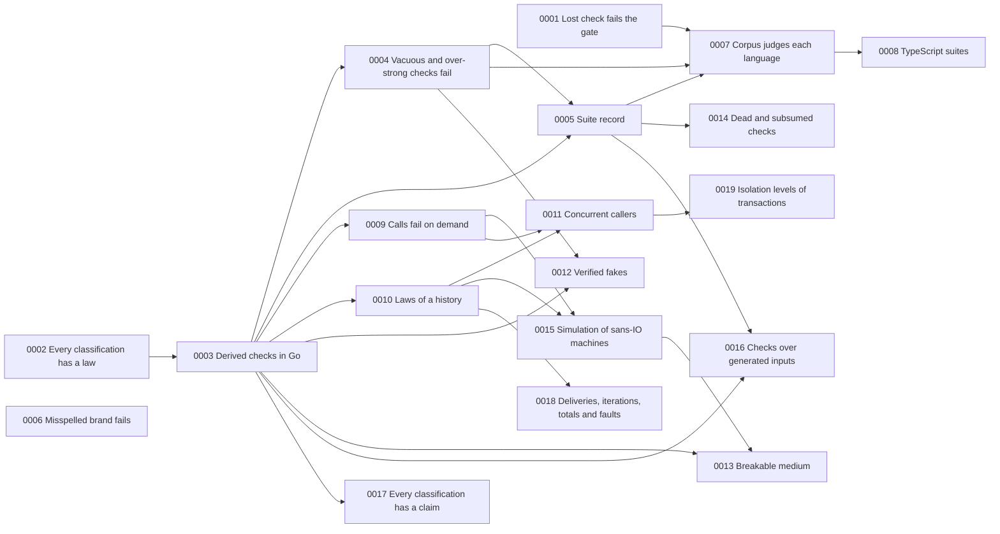

<!--
  ~ Copyright Dokimasia B.V. 2026
  ~ SPDX-License-Identifier: Apache-2.0
-->

# Roadmap

What we are building, in what order, and what has to be true first. Milestone numbers are permanent. The order is the order of this table, and it changes.

| Order | Milestone | Status | Depends on | Released in |
|---|---|---|---|---|
| 1 | [0001](0001-a-lost-check-fails-the-gate.md) A lost check fails the generation gate | Done | none | unscheduled |
| 2 | [0002](0002-every-classification-has-a-law.md) Every classification has a law or a stance | Done | none | 0.7.0 |
| 3 | [0003](0003-go-declarations-get-derived-checks.md) A Go declaration gets derived checks | Done | 0002 | unscheduled |
| 4 | [0004](0004-vacuous-and-over-strong-checks-fail.md) Vacuous and over-strong checks fail | Done | 0003 | unscheduled |
| 5 | [0005](0005-a-run-writes-its-suite-record.md) A run writes its suite record | Done | 0003, 0004 | unscheduled |
| 6 | [0006](0006-a-misspelled-brand-fails-the-run.md) A misspelled brand fails the run | Done | none | unscheduled |
| 7 | [0007](0007-the-corpus-judges-each-language.md) The corpus judges each language by its records | Done | 0001, 0004, 0005 | unscheduled |
| 8 | [0009](0009-calls-fail-on-demand.md) A check can make a call fail on demand | Done | 0003 | unscheduled |
| 9 | [0016](0016-derived-checks-over-generated-inputs.md) A derived check runs over generated inputs | Done | 0003, 0005 | unscheduled |
| 10 | [0017](0017-every-classification-has-a-claim.md) Every classification of the shape catalog has a claim | Done | 0003 | unscheduled |
| 11 | [0010](0010-sequences-against-a-reference.md) Laws of a history are judged over generated sequences | Done | 0003 | unscheduled |
| 12 | [0018](0018-deliveries-iterations-totals-and-faults.md) Deliveries, iterations, totals and failed calls are judged over generated sequences | Done | 0010 | unscheduled |
| 13 | [0015](0015-a-simulation-of-sans-io-machines.md) A system of sans-IO machines runs in a deterministic simulation | In progress | 0009, 0010 | unscheduled |
| 14 | [0011](0011-concurrent-callers.md) Concurrent callers are checked for linearizability | Done | 0009, 0010 | unscheduled |
| 15 | [0019](0019-the-isolation-levels-of-transactions.md) Transactions are checked for their isolation level | Planned | 0011 | unscheduled |
| 16 | [0012](0012-verified-fakes.md) A downstream team uses a verified fake | Done | 0003, 0004 | unscheduled |
| 17 | [0013](0013-a-breakable-medium.md) A durable subject survives a breakable medium | Done | 0003, 0015 | unscheduled |
| 18 | [0014](0014-dead-and-subsumed-checks.md) A report names dead and subsumed checks | Done | 0005 | unscheduled |
| 19 | [0008](0008-typescript-declarations-get-proven-suites.md) A TypeScript declaration gets a proven suite | Planned | 0007 | unscheduled |

## Capabilities without a milestone

RFC-0001 gives each of these the verdict In. None has a position in the order yet.

| Capability | What it needs first |
|---|---|
| Clock skew, drift, rollback and bounded uncertainty | Milestone 0003 |
| Cross-version evolution | Milestone 0013 |
| Replay of recorded call sequences | Milestone 0010 |
| A finding for an expected value that flows from the subject | Milestone 0003 |
| Contradictions between a declaration and its implementation | Milestone 0010 |
| Directive proposals that a person accepts | Milestone 0006 |
| Packs of laws from third parties | Milestone 0008 |
| A signature over a bundle and its lock | Milestones 0001 and 0005 |
| A compiler from a counterexample of a model checker to a check | Milestone 0010 |
| A library of laws from incidents | Milestone 0002 |
| The plan beside the declaration in an editor | Milestone 0003 |
| Debugging that steps back and forth through a trace | Milestone 0015 |
| The workloads and checkers of a simulation against a real cluster | Milestone 0015 |
| Language bindings beyond TypeScript | Milestone 0008, and the rules of each language in eidos |
